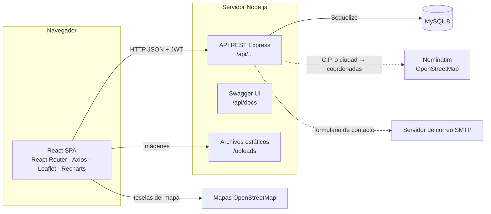
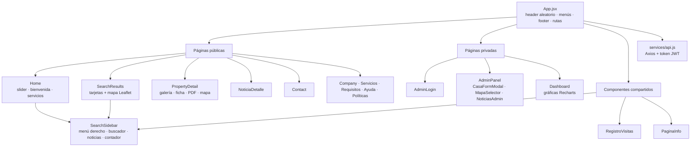
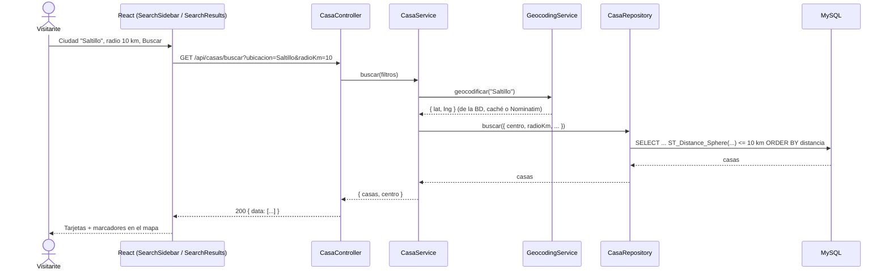
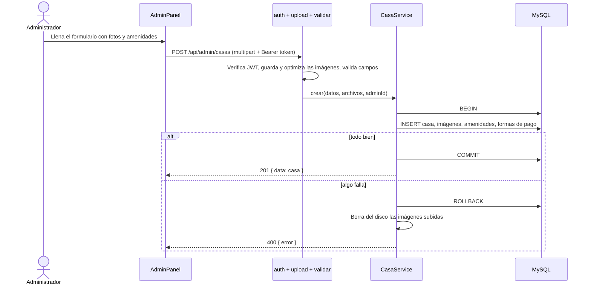
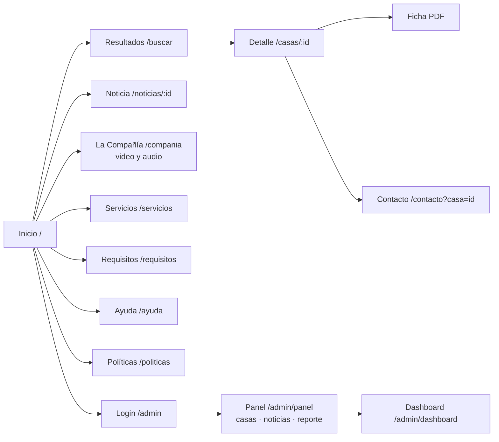
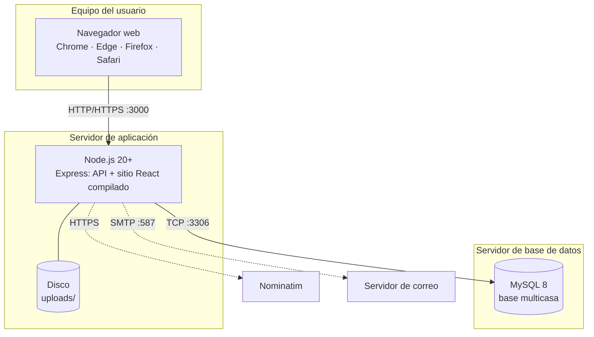

# Documento de diseño y arquitectura — MultiCasa

Este documento describe cómo está construido **MultiCasa**: la arquitectura general, los componentes, los patrones de diseño, la estructura de directorios, el diseño de la API REST, las pantallas y el despliegue.

## 1. Visión general

MultiCasa es una aplicación web de bienes raíces con dos partes:

- **Sitio público:** catálogo de casas en venta, búsqueda por ubicación y radio con mapa, detalle con galería y ficha en PDF, noticias, contador de visitas, contacto, video y audio.
- **Sitio privado (administradores):** login, alta, edición y baja de casas y noticias, marcar casas como vendidas, reporte de todas las casas y dashboard con gráficas.

Se eligió una arquitectura **cliente-servidor de tres capas** con una API REST entre el frontend y el backend:

| Capa | Tecnología | Responsabilidad |
|---|---|---|
| Presentación | React 19 + Vite + React-Bootstrap | Pantallas, navegación, formularios, mapa y gráficas. Consume la API con Axios |
| Lógica de negocio | Node.js + Express | API REST, validaciones, reglas de negocio, autenticación, PDF y reportes |
| Datos | MySQL 8 + Sequelize (ORM) | Tablas, relaciones, vistas del dashboard, migraciones y datos de prueba |



## 2. Diagrama de componentes

### 2.1 Backend

Cada petición pasa por las mismas capas. Cada capa tiene una sola responsabilidad y solo conoce a la capa de abajo:

```mermaid
flowchart TB
    REQ[Petición HTTP] --> MW

    subgraph MW[Middlewares]
        direction LR
        CORS[cors] --> JSON[express.json] --> AUTH[auth JWT<br/>solo /api/admin] --> UPL[upload multer + sharp] --> VAL[validar<br/>express-validator]
    end

    MW --> RT[Routes<br/>src/routes]
    RT --> CT[Controllers<br/>leen req, responden JSON]
    CT --> SV[Services<br/>reglas de negocio]
    SV --> RP[Repositories<br/>consultas Sequelize]
    RP --> MD[Models<br/>Sequelize]
    MD --> DB[(MySQL)]

    SV --> EXT[Servicios de apoyo<br/>MailService · GeocodingService<br/>DocumentoPdf · ReportePdf / ReporteExcel]
    CT -.error.-> EH[errorHandler<br/>respuesta { error }]
```

| Componente | Carpeta | Ejemplos |
|---|---|---|
| Rutas | `backend/src/routes` | `casa.routes.js`, `admin.routes.js`, `auth.routes.js` |
| Controladores | `backend/src/controllers` | `CasaController`, `AdminCasaController`, `ReporteController` |
| Servicios | `backend/src/services` | `CasaService`, `AuthService`, `GeocodingService`, `FichaPdfService`, `ReporteService` |
| Repositorios | `backend/src/repositories` | `BaseRepository`, `CasaRepository`, `NoticiaRepository`, `DashboardRepository` |
| Modelos | `backend/src/models` | `Casa`, `ImagenCasa`, `Amenidad`, `FormaPago`, `Noticia`, `Visita`, `Administrador`, `MensajeContacto` |
| Middlewares | `backend/src/middlewares` | `auth`, `upload`, `validar`, `errorHandler`, `notFound` |
| Validadores | `backend/src/validators` | reglas de `express-validator` por módulo |
| PDF y reportes | `backend/src/pdf`, `backend/src/reportes` | `DocumentoPdf` (Builder), `ReportePdf` y `ReporteExcel` (Strategy) |
| Configuración | `backend/src/config` | `env.js` (variables), `Database.js` (Singleton), `swagger.js` |

### 2.2 Frontend



## 3. Patrones de diseño

| Patrón | Dónde | Para qué |
|---|---|---|
| **Arquitectura en capas** (Controller → Service → Repository) | Todo el backend | Separar HTTP, reglas de negocio y acceso a datos. Cada capa se puede probar por separado |
| **Singleton** | `config/Database.js` | Una sola conexión (pool) a MySQL en toda la aplicación. `new Database()` lanza error; siempre se usa `Database.getInstance()` |
| **Repository** | `repositories/BaseRepository.js` y sus hijas | Único lugar que habla con Sequelize. `BaseRepository` es abstracta y ya trae `findAll`, `findById`, `findByIdOrFail`, `create`, `update`, `delete` |
| **Strategy** | `services/ReporteService.js`, `reportes/ReportePdf.js`, `reportes/ReporteExcel.js` | El reporte se genera en PDF o Excel con la misma interfaz `generar(datos)`. Agregar un formato no cambia el servicio ni el controlador |
| **Builder** | `pdf/DocumentoPdf.js` | Arma los PDF paso a paso encadenando métodos: `encabezado()`, `titular()`, `imagen()`, `datos()`, `tabla()`... |
| **Inyección de dependencias** | Constructores de controllers y services | `new CasaService({ casaRepository })`: en las pruebas se pasa un repositorio simulado |
| **Middleware (cadena de responsabilidad)** | `middlewares/` | Autenticación, subida de archivos, validación y manejo de errores como pasos independientes |

## 4. Estructura de directorios

```
multiCasaDesarrollo/
├── package.json            # build y start para publicar (backend + frontend en un servicio)
├── backend/
│   ├── src/
│   │   ├── app.js          # clase App: arma Express (middlewares, rutas, errores)
│   │   ├── server.js       # conecta la BD y levanta el servidor
│   │   ├── config/         # env.js, Database.js (Singleton), swagger.js
│   │   ├── routes/         # rutas de Express montadas en /api (con documentación @openapi)
│   │   ├── controllers/    # leen req y responden { data }
│   │   ├── services/       # reglas de negocio
│   │   ├── repositories/   # consultas con Sequelize (BaseRepository)
│   │   ├── models/         # modelos de Sequelize y relaciones
│   │   ├── middlewares/    # auth, upload, validar, errorHandler, notFound
│   │   ├── validators/     # reglas de express-validator
│   │   ├── pdf/            # DocumentoPdf (Builder)
│   │   ├── reportes/       # ReportePdf y ReporteExcel (Strategy)
│   │   ├── utils/          # AppError, asyncHandler, archivos, optimizarImagen
│   │   └── database/       # migraciones, seeders y datos de prueba
│   ├── tests/              # Jest + Supertest (175 pruebas)
│   ├── scripts/            # optimizar-seed.js
│   └── uploads/            # imágenes (seed/ se versiona; casas/ y noticias/ no)
├── frontend/
│   ├── public/             # imágenes del header, video, audio y exportación del PSD
│   └── src/
│       ├── App.jsx         # layout del PSD y rutas
│       ├── pages/          # una página por pantalla
│       ├── components/     # barra lateral, panel de admin, registro de visitas
│       └── services/api.js # cliente Axios de la API
└── docs/                   # documentación del proyecto
```

## 5. Diseño de la API REST

- Base: `/api`. Documentación interactiva en **`/api/docs`** (Swagger / OpenAPI 3).
- Formato de éxito: `{ "data": ... }`. Formato de error: `{ "error": { "codigo", "mensaje", "detalles" } }`.
- Rutas de administrador (`/api/admin/...`): requieren `Authorization: Bearer <token>` (JWT de 8 horas).
- Códigos HTTP: `200` OK, `201` creado, `204` borrado, `400` datos inválidos, `401` sin sesión, `404` no encontrado, `503` servicio externo no disponible.

| Método | Ruta | Acceso | Descripción |
|---|---|---|---|
| GET | `/api/health` | Público | Estado del servidor y de la BD |
| POST | `/api/auth/login` | Público | Login de administrador → token JWT |
| GET | `/api/casas/destacadas` | Público | Casas destacadas (slider) |
| GET | `/api/casas/buscar` | Público | Búsqueda por C.P. o ciudad + radio, precio, recámaras y baños |
| GET | `/api/casas/{id}` | Público | Detalle de una casa en venta |
| GET | `/api/casas/{id}/pdf` | Público | Ficha técnica en PDF |
| GET | `/api/amenidades` | Público | Catálogo de amenidades |
| GET | `/api/formas-pago` | Público | Formas de pago y requisitos |
| GET | `/api/noticias` | Público | Noticias activas |
| GET | `/api/noticias/{id}` | Público | Noticia completa ("Ver más...") |
| POST | `/api/visitas` | Público | Registra una visita |
| GET | `/api/visitas/resumen` | Público | Visitas y conectados |
| POST | `/api/contacto` | Público | Formulario de contacto |
| GET | `/api/admin/perfil` | Admin | Datos del administrador |
| GET | `/api/admin/casas` | Admin | Todas las casas con filtros y paginación |
| POST | `/api/admin/casas` | Admin | Alta con imágenes, amenidades y formas de pago |
| GET | `/api/admin/casas/{id}` | Admin | Detalle (incluye vendidas) |
| PUT | `/api/admin/casas/{id}` | Admin | Edición |
| DELETE | `/api/admin/casas/{id}` | Admin | Baja (y borra sus imágenes) |
| PATCH | `/api/admin/casas/{id}/estatus` | Admin | Marcar como vendida o en venta |
| DELETE | `/api/admin/casas/{id}/imagenes/{imagenId}` | Admin | Borrar una imagen |
| GET | `/api/admin/noticias` | Admin | Todas las noticias |
| POST | `/api/admin/noticias` | Admin | Alta de noticia |
| GET | `/api/admin/noticias/{id}` | Admin | Detalle de noticia |
| PUT | `/api/admin/noticias/{id}` | Admin | Edición de noticia |
| DELETE | `/api/admin/noticias/{id}` | Admin | Baja de noticia |
| GET | `/api/admin/dashboard/rangos-precio` | Admin | Casas por rango de precio |
| GET | `/api/admin/dashboard/estatus` | Admin | Vendidas vs. en venta |
| GET | `/api/admin/reportes/casas` | Admin | Reporte de todas las casas en PDF o Excel |

### 5.1 Secuencia: búsqueda de casas



### 5.2 Secuencia: alta de una casa (administrador)



## 6. Diseño de pantallas y navegación

El diseño visual sigue el archivo de Photoshop `Bienes_Raices.psd` (exportado en `frontend/public/psd-export/`): header con imagen aleatoria, menú superior con rollover, links "Inicio · Buscar · Admin.", menú derecho con over state, barra lateral con buscador, noticias y contador, y footer con links.



| Ruta | Pantalla | Contenido |
|---|---|---|
| `/` | Inicio | Slider de casas destacadas, Bienvenido, Servicios destacados, barra lateral |
| `/buscar` | Resultados | Tarjetas de casas y mapa con un marcador por casa y el círculo del radio |
| `/casas/:id` | Detalle | Galería, ficha técnica, amenidades interiores y exteriores, formas de pago, PDF, "Me interesa", mapa |
| `/noticias/:id` | Noticia | Noticia completa |
| `/contacto` | Contacto | Formulario (nombre, correo, teléfono, asunto, mensaje), prellenado desde "Me interesa" |
| `/compania` | La Compañía | Información de la empresa, video de presentación y audio de consejos |
| `/servicios`, `/requisitos`, `/ayuda`, `/politicas` | Informativas | Contenido real de servicios, requisitos de crédito, preguntas frecuentes y políticas |
| `/admin` | Login | Correo y contraseña |
| `/admin/panel` | Panel | Tabla de casas (alta, edición, vendida, baja), noticias y botones de reporte |
| `/admin/dashboard` | Dashboard | Gráfica de barras por rango de precio y gráfica de pastel de vendidas vs. en venta |

**Diseño responsivo:** en pantallas de menos de 992 px la barra lateral pasa debajo del contenido, el menú principal se vuelve hamburguesa y las rejillas de tarjetas pasan a una columna.

## 7. Diagrama de despliegue



En desarrollo el frontend corre aparte con Vite (puerto 5173) y la API en el puerto 3000. En producción el backend sirve el sitio compilado y la API en la misma URL. El detalle está en el [documento de implementación](../implementacion/README.md).

## 8. Seguridad

| Riesgo | Medida |
|---|---|
| Acceso no autorizado al panel | JWT firmado con `JWT_SECRET` y vigencia de 8 h; middleware `auth` en todo `/api/admin` |
| Robo de contraseñas | Contraseñas con hash **bcrypt**; el hash nunca se regresa en la API |
| Enumeración de usuarios | El login responde el mismo error si el correo no existe o la contraseña es incorrecta |
| Datos inválidos o maliciosos | Validación de cada campo con `express-validator`; consultas parametrizadas por Sequelize |
| Archivos maliciosos | Solo jpg, png o webp de hasta 5 MB; `sharp` confirma que el contenido es una imagen real y la recodifica |
| Privacidad de visitantes | No se guarda la IP: solo `SHA-256(IP + navegador + VISITAS_SALT)` |
| Spam en el formulario | Campo trampa invisible para bots |
| Datos a medias | Altas y ediciones de casas en una **transacción**: si algo falla se hace ROLLBACK y se borran las imágenes subidas |

## 9. Decisiones tecnológicas

| Decisión | Alternativas | Por qué |
|---|---|---|
| React + Vite | Angular, HTML con jQuery | Componentes reutilizables (barra lateral en varias páginas), recarga rápida en desarrollo |
| Express | NestJS, PHP (prohibido) | Ligero, el equipo ya lo conocía, fácil de organizar en capas |
| MySQL + Sequelize | MongoDB, consultas SQL a mano | Datos relacionales (casas, imágenes, amenidades); el ORM da migraciones, seeders y validaciones |
| Leaflet + OpenStreetMap | Google Maps | Gratis y sin llave de API |
| Recharts | Chart.js | Gráficas como componentes de React |
| pdfkit y exceljs | Generar HTML e imprimir | PDF y Excel generados en el servidor, iguales en cualquier navegador |
| JWT | Sesiones en el servidor | La API no guarda estado; el token viaja en cada petición |
