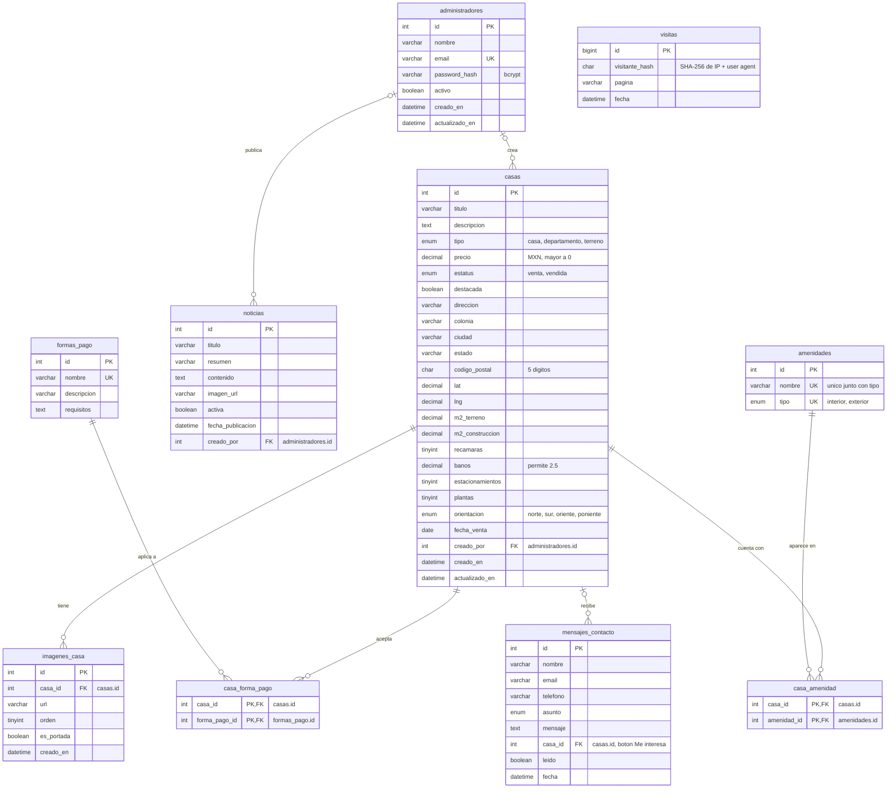

# Modelo físico de la base de datos

Este documento describe el modelo físico de la base de datos de **MultiCasa** (MySQL 8). El script [`multicasa_database.sql`](multicasa_database.sql) es la **referencia de diseño**: define las 10 tablas, sus llaves, índices, restricciones, las 2 vistas del dashboard y los datos de catálogo (formas de pago, amenidades y un administrador de prueba). La base de datos real del proyecto **no** se crea con este script, sino con las **migraciones y seeders de Sequelize** (issue #8), que deben reflejar este mismo modelo.

Convenciones del modelo:

- Tablas y columnas en `snake_case` (en Sequelize se usa `underscored: true` para trabajarlas en `camelCase`).
- Todas las tablas usan `id INT AUTO_INCREMENT` como llave primaria, excepto `visitas` (`BIGINT`) y las tablas puente, que usan una llave primaria compuesta.
- Motor `InnoDB` y juego de caracteres `utf8mb4` / `utf8mb4_unicode_ci`.

## Diagrama entidad-relación



`visitas` no tiene relaciones: solo registra cada visita para el contador de la barra lateral.

### Llaves foráneas y acciones al borrar

| Llave foránea | Columna | Referencia | `ON DELETE` |
|---|---|---|---|
| `fk_casas_admin` | `casas.creado_por` | `administradores.id` | `SET NULL` |
| `fk_imagenes_casa` | `imagenes_casa.casa_id` | `casas.id` | `CASCADE` |
| `fk_cfp_casa` | `casa_forma_pago.casa_id` | `casas.id` | `CASCADE` |
| `fk_cfp_forma_pago` | `casa_forma_pago.forma_pago_id` | `formas_pago.id` | `RESTRICT` |
| `fk_ca_casa` | `casa_amenidad.casa_id` | `casas.id` | `CASCADE` |
| `fk_ca_amenidad` | `casa_amenidad.amenidad_id` | `amenidades.id` | `RESTRICT` |
| `fk_noticias_admin` | `noticias.creado_por` | `administradores.id` | `SET NULL` |
| `fk_mensajes_casa` | `mensajes_contacto.casa_id` | `casas.id` | `SET NULL` |

En resumen: al borrar una casa se borran sus imágenes y sus asignaciones de formas de pago y amenidades, y los mensajes que la mencionan se conservan. No se puede borrar una forma de pago ni una amenidad mientras alguna casa la tenga asignada. Si se borra un administrador, sus casas y noticias se conservan con `creado_por = NULL`.

## Resumen de tablas

| Tabla | Para qué sirve | Relaciones |
|---|---|---|
| `administradores` | Usuarios del sitio privado. Un solo tipo de administrador, con contraseña en bcrypt. | 1 → N `casas` y 1 → N `noticias` (opcional, por `creado_por`) |
| `casas` | Ficha técnica de cada propiedad: datos generales, ubicación con coordenadas, características y control de venta. | N → 1 `administradores`; 1 → N `imagenes_casa` y `mensajes_contacto`; N ↔ M `formas_pago` y `amenidades` |
| `imagenes_casa` | Fotos de cada casa (rutas de archivos subidos con multer), con orden y portada. | N → 1 `casas` |
| `formas_pago` | Catálogo de formas de pago y sus requisitos (página Requisitos). | N ↔ M `casas` mediante `casa_forma_pago` |
| `casa_forma_pago` | Tabla puente: qué formas de pago acepta cada casa. | N → 1 `casas`, N → 1 `formas_pago` |
| `amenidades` | Catálogo de amenidades interiores y exteriores. | N ↔ M `casas` mediante `casa_amenidad` |
| `casa_amenidad` | Tabla puente: qué amenidades tiene cada casa. | N → 1 `casas`, N → 1 `amenidades` |
| `noticias` | Noticias de última hora de la barra lateral (resumen y contenido de "Ver más..."). | N → 1 `administradores` (opcional) |
| `visitas` | Registro de visitas para el contador de Visitas y Conectados (últimos 5 minutos). | Ninguna |
| `mensajes_contacto` | Mensajes del formulario de contacto, que además se envían por correo. | N → 1 `casas` (opcional, si vienen del botón "Me interesa") |

## Índices

Índices creados explícitamente con `CREATE INDEX`:

| Índice | Tabla | Columnas | Uso |
|---|---|---|---|
| `ix_casas_estatus_precio` | `casas` | `estatus, precio` | Búsqueda pública (solo casas en venta, por rango de precio) y dashboard |
| `ix_casas_codigo_postal` | `casas` | `codigo_postal` | Búsqueda por código postal |
| `ix_casas_ciudad_estado` | `casas` | `ciudad, estado` | Búsqueda y reporte por ubicación |
| `ix_casas_ubicacion` | `casas` | `lat, lng` | Búsqueda por distancia (km) y mapa |
| `ix_imagenes_casa_orden` | `imagenes_casa` | `casa_id, orden` | Obtener las imágenes de una casa en orden |
| `ix_noticias_activa_fecha` | `noticias` | `activa, fecha_publicacion` | Listar noticias activas de la más reciente a la más antigua |
| `ix_visitas_fecha` | `visitas` | `fecha` | Contar conectados de los últimos 5 minutos |

Restricciones `UNIQUE` (también crean índice):

| Restricción | Tabla | Columnas |
|---|---|---|
| `uq_administradores_email` | `administradores` | `email` |
| `uq_formas_pago_nombre` | `formas_pago` | `nombre` |
| `uq_amenidades_nombre_tipo` | `amenidades` | `nombre, tipo` |

Restricciones `CHECK` en `casas`: `chk_casas_precio` (precio > 0), `chk_casas_cp` (C.P. de 5 dígitos), `chk_casas_lat` (entre -90 y 90) y `chk_casas_lng` (entre -180 y 180).

Además, InnoDB crea automáticamente un índice para cada llave foránea que no esté cubierta por otro índice.

## Vistas

| Vista | Qué devuelve | Uso |
|---|---|---|
| `v_casas_por_rango_precio` | `rango`, `orden`, `total`: número de casas en cada rango de precio (menos de $1 M, $1 M - $2 M, $2 M - $4 M, $4 M - $7 M y más de $7 M), ordenadas por `orden`. | Gráfica de casas por rango de precio en el dashboard |
| `v_casas_por_estatus` | `estatus`, `total`: número de casas en venta y vendidas. | Gráfica de vendidas vs. en venta en el dashboard |

El script también incluye, comentadas, las consultas de referencia para la búsqueda pública por C.P. + km (`ST_Distance_Sphere`) y para el contador de visitas y conectados.

## Cómo cargar el script manualmente

Solo es necesario si quieres revisar el modelo en tu MySQL local. Para desarrollar, usa las migraciones de Sequelize.

> **Cuidado:** el script empieza con `DROP DATABASE IF EXISTS multicasa;`, así que **borra** la base `multicasa` si ya existe. Si quieres conservar la que creaste con migraciones, cambia el nombre en el script antes de cargarlo.

Desde la raíz del repositorio (Git Bash, macOS/Linux o `cmd`):

```bash
mysql -u root -p < docs/base-de-datos/multicasa_database.sql
```

En PowerShell el operador `<` no funciona; usa:

```powershell
Get-Content docs/base-de-datos/multicasa_database.sql -Raw | mysql -u root -p
```

Para comprobar que se creó todo:

```sql
USE multicasa;
SHOW FULL TABLES;                         -- 10 tablas (BASE TABLE) y 2 vistas (VIEW)
SELECT * FROM v_casas_por_estatus;
SELECT nombre FROM formas_pago;           -- 5 formas de pago de catálogo
```

El script crea un administrador de prueba (`admin@multicasa.com`); la contraseña está en el comentario del propio script y debe cambiarse antes de la entrega.
