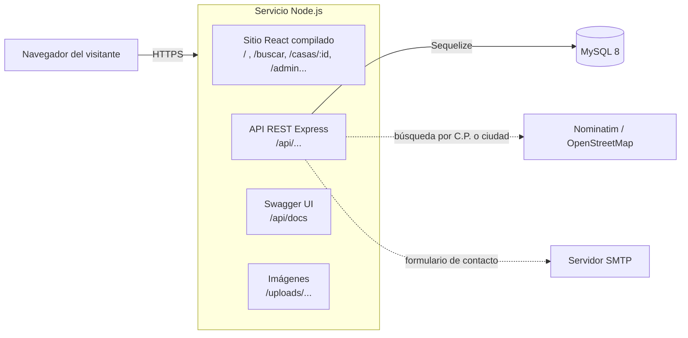

# Documento de implementación — MultiCasa

Este documento explica cómo instalar, configurar y publicar **MultiCasa** (issue #31). Incluye el manual de instalación local, el despliegue en un servidor y la verificación final.

## 1. Arquitectura de despliegue

En producción todo el sistema corre como **un solo servicio de Node.js** más una base de datos MySQL:

- El **backend** (Express) atiende la API en `/api`, la documentación en `/api/docs` y las imágenes en `/uploads`.
- El **frontend** (React) se compila con Vite a archivos estáticos (`frontend/dist`) y **el mismo backend los sirve**. Cualquier otra ruta (`/buscar`, `/casas/3`, `/admin/panel`...) regresa `index.html` para que React Router la resuelva.
- Así el sitio y la API comparten la misma URL: no hace falta configurar CORS ni la URL de la API.



En **desarrollo** se usan dos procesos separados (Vite en el puerto 5173 y la API en el 3000) para tener recarga automática.

| Componente | Tecnología | Puerto local |
|---|---|---|
| Frontend | React 19 + Vite + React-Bootstrap | 5173 (solo en desarrollo) |
| Backend | Node.js + Express + Sequelize | 3000 |
| Base de datos | MySQL 8 | 3306 |

## 2. Requisitos

| Software | Versión | Para qué |
|---|---|---|
| Node.js | 20 o superior (incluye npm) | Correr el backend y compilar el frontend |
| MySQL | 8 (o MariaDB 10.6+ de XAMPP) | Base de datos |
| Git | cualquiera | Descargar el repositorio |

Servicios externos opcionales:

- **Nominatim (OpenStreetMap)**: convierte un C.P. o ciudad en coordenadas para la búsqueda por radio. No necesita cuenta. Primero se buscan las coordenadas en las casas de la BD y solo se llama a Nominatim si no están.
- **Correo SMTP** (por ejemplo Gmail): para que el formulario de contacto envíe correo. Sin esto los mensajes **sí se guardan** en la tabla `mensajes_contacto`, pero no sale ningún correo.

## 3. Manual de instalación local

### 3.1 Descargar el proyecto

```bash
git clone https://github.com/miwaangel/multiCasaDesarrollo.git
cd multiCasaDesarrollo
```

### 3.2 Encender MySQL

Con XAMPP: abrir el **XAMPP Control Panel** y dar **Start** en *MySQL*. Debe quedar escuchando en el puerto 3306.

### 3.3 Backend

```bash
cd backend
npm install
copy .env.example .env        # en Mac/Linux: cp .env.example .env
```

Editar `backend/.env`. Lo mínimo:

| Variable | Valor |
|---|---|
| `DB_USER` / `DB_PASSWORD` | Usuario y contraseña de MySQL (en XAMPP: `root` y vacía) |
| `JWT_SECRET` | Texto largo y aleatorio: `node -e "console.log(require('crypto').randomBytes(64).toString('hex'))"` |
| `VISITAS_SALT` | Otro texto aleatorio: `node -e "console.log(require('crypto').randomBytes(32).toString('hex'))"` |

Crear la base de datos con sus tablas y datos de prueba:

```bash
npm run db:create     # crea la base "multicasa" (utf8mb4)
npm run db:migrate    # 10 tablas + 2 vistas del dashboard
npm run db:seed       # admin, catálogos, 20 casas con fotos y 3 noticias
npm run dev           # API en http://localhost:3000/api
```

Comprobar: abrir http://localhost:3000/api/health → `{"data":{"estado":"ok","baseDeDatos":"conectada",...}}`.

### 3.4 Frontend

En **otra terminal** (la del backend debe seguir abierta):

```bash
cd frontend
npm install
copy .env.example .env        # VITE_API_URL=http://localhost:3000/api
npm run dev                   # sitio en http://localhost:5173
```

Si el puerto 5173 está ocupado por otro proyecto, usar otro (`npm run dev -- --port 5174`) y poner el mismo en `CORS_ORIGIN` del `backend/.env` (`CORS_ORIGIN=http://localhost:5174`); después reiniciar el backend.

### 3.5 Acceso de administrador

Link **Admin.** del menú superior (http://localhost:5173/admin):

- Correo: `admin@multicasa.com`
- Contraseña: la de `SEED_ADMIN_PASSWORD` en `backend/.env`; si está vacía, `Admin123!`

### 3.6 Correr como en producción (un solo puerto)

Para probar en local exactamente lo que se publica:

```bash
# desde la raíz del repositorio
npm run build     # instala dependencias y compila el frontend en frontend/dist
npm start         # migra, carga seeders y levanta todo en http://localhost:3000
```

> Al terminar de probar, borrar `frontend/dist` si se va a volver a usar `npm run dev`; si no, el backend también seguirá sirviendo ese build viejo en http://localhost:3000.

## 4. Variables de entorno

Todas se leen en `backend/src/config/env.js`. El ejemplo completo está en `backend/.env.example`.

| Variable | Obligatoria | Default | Descripción |
|---|---|---|---|
| `PORT` | No | `3000` | Puerto del servidor (las plataformas de hosting lo ponen solas) |
| `NODE_ENV` | No | `development` | `production` en el servidor |
| `DB_HOST`, `DB_PORT`, `DB_NAME`, `DB_USER`, `DB_PASSWORD` | **Sí** | `localhost`, `3306`, `multicasa`, `root`, vacía | Conexión a MySQL |
| `JWT_SECRET` | **Sí** | — | Firma de los tokens del login de administradores |
| `JWT_EXPIRES_IN` | No | `8h` | Duración de la sesión del administrador |
| `VISITAS_SALT` | Recomendada | vacía | Se mezcla con IP + navegador para el hash del visitante (nunca se guarda la IP) |
| `SEED_ADMIN_PASSWORD` | No | `Admin123!` | Contraseña del admin que crean los seeders. **Cambiarla en producción** |
| `CORS_ORIGIN` | No | `http://localhost:5173` | Solo importa si el frontend se publica en otro dominio |
| `FRONTEND_DIR` | No | `frontend/dist` | Carpeta del build del frontend que sirve el backend |
| `UPLOADS_DIR` | No | `backend/uploads` | Carpeta de imágenes subidas desde el panel |
| `GEOCODING_HABILITADO` | No | `true` (`false` en pruebas) | Búsqueda de C.P./ciudades en Nominatim |
| `GEOCODING_USER_AGENT` | No | `MultiCasa/1.0 (proyecto escolar)` | Nominatim pide identificar la aplicación |
| `MAIL_HOST`, `MAIL_PORT`, `MAIL_USER`, `MAIL_PASSWORD` | No | vacías, `587` | Servidor SMTP del formulario de contacto |
| `MAIL_TO`, `MAIL_FROM` | No | vacías | A quién llegan los mensajes y quién aparece como remitente |
| `VITE_API_URL` (frontend) | No | `/api` en el build, `http://localhost:3000/api` en desarrollo | URL de la API que usa React |

**Correo con Gmail:** `MAIL_HOST=smtp.gmail.com`, `MAIL_PORT=587`, `MAIL_USER=<cuenta>@gmail.com` y en `MAIL_PASSWORD` una *contraseña de aplicación* de 16 letras (Cuenta de Google → Seguridad → Verificación en 2 pasos → Contraseñas de aplicaciones).

## 5. Despliegue en un servidor

El repositorio ya trae lo necesario para publicarse en cualquier plataforma que corra Node.js con MySQL. En la raíz hay un `package.json` con dos comandos:

| Comando | Qué hace |
|---|---|
| `npm run build` | Instala dependencias del backend y del frontend, y compila el frontend en `frontend/dist` |
| `npm start` | Aplica migraciones pendientes, carga los seeders que falten y levanta el servidor |

Migraciones y seeders se pueden correr en cada arranque: Sequelize registra cuáles ya se ejecutaron (tablas `sequelize_meta` y `sequelize_data`) y nunca los repite.

### 5.1 Opción recomendada: Railway

Railway ofrece Node.js y MySQL en el mismo proyecto.

1. Entrar a https://railway.com con la cuenta de GitHub.
2. **New Project → Deploy from GitHub repo →** elegir `multiCasaDesarrollo` (rama `main`).
3. En el mismo proyecto: **New → Database → MySQL**.
4. En el servicio de la app → **Variables**, agregar:

   ```
   NODE_ENV=production
   DB_HOST=${{MySQL.MYSQLHOST}}
   DB_PORT=${{MySQL.MYSQLPORT}}
   DB_NAME=${{MySQL.MYSQLDATABASE}}
   DB_USER=${{MySQL.MYSQLUSER}}
   DB_PASSWORD=${{MySQL.MYSQLPASSWORD}}
   JWT_SECRET=<texto aleatorio de 64 bytes>
   VISITAS_SALT=<texto aleatorio de 32 bytes>
   SEED_ADMIN_PASSWORD=<contraseña segura para el admin>
   ```

   Opcional: las variables `MAIL_*` para que el formulario de contacto envíe correos.
5. En **Settings** del servicio confirmar *Build Command* `npm run build` y *Start Command* `npm start` (Railway los detecta solos por el `package.json` de la raíz).
6. **Settings → Networking → Generate Domain** para obtener la URL pública (por ejemplo `https://multicasa-production.up.railway.app`).
7. Esperar a que el *deploy* quede en verde y abrir la URL.

**Imágenes subidas desde el panel:** el disco del servicio se reinicia en cada despliegue. Las fotos de los seeders viven en el repositorio y siempre están, pero las que se suban desde el panel se pierden al volver a publicar. Para conservarlas: **New → Volume** montado en `/data` y agregar la variable `UPLOADS_DIR=/data/uploads`. El backend sigue sirviendo las fotos de los seeders desde la carpeta del repositorio.

### 5.2 Otras opciones

- **Render, Fly.io o un VPS**: mismo procedimiento. Build `npm run build`, start `npm start` y las variables de la sección 4. La base MySQL puede ser del mismo proveedor o externa (Aiven, por ejemplo).
- **Frontend en otro dominio** (Vercel, Netlify): compilar con `VITE_API_URL=https://<url-del-backend>/api` y poner esa URL del frontend en `CORS_ORIGIN` del backend.

## 6. Verificación después de publicar

| # | Qué revisar | Resultado esperado |
|---|---|---|
| 1 | `https://<dominio>/api/health` | `estado: ok`, `baseDeDatos: conectada` |
| 2 | `https://<dominio>/` | Home con slider de casas destacadas y fotos |
| 3 | Buscar por ciudad (Saltillo) con radio de 10 km | Resultados con mapa y marcadores |
| 4 | Abrir una casa y recargar la página (F5) | Carga el detalle, no da 404 |
| 5 | Descargar la ficha en PDF | Se descarga el PDF con fotos |
| 6 | Login en `/admin` | Entra al panel |
| 7 | Alta de una casa con imagen PNG | Se guarda y la imagen se ve |
| 8 | Dashboard y reporte (PDF y Excel) | Gráficas con datos y archivos descargados |
| 9 | `https://<dominio>/api/docs` | Swagger con los 29 endpoints |

## 7. Actualizar el sistema

1. Hacer merge del cambio a `main`.
2. La plataforma vuelve a construir y publicar sola (en Railway, cada *push* a la rama configurada dispara un despliegue).
3. Las migraciones nuevas se aplican solas al arrancar (`npm start`).

Para regresar a una versión anterior: en Railway, **Deployments →** elegir el despliegue anterior **→ Redeploy**. Si la versión nueva traía una migración, revertirla antes con `npm run db:undo` desde la consola del servicio.

## 8. Problemas comunes

| Síntoma | Causa | Solución |
|---|---|---|
| `ERR_CONNECTION_REFUSED` en la consola del navegador; no cargan búsqueda ni imágenes | El backend no está corriendo | Levantar el backend (`npm run dev` en `backend/`) y dejar esa terminal abierta |
| El backend se cierra con `No se pudo conectar a la BD` | MySQL apagado o datos `DB_*` incorrectos | Encender MySQL en XAMPP y revisar `backend/.env` |
| Error de CORS en la consola | El frontend corre en un puerto distinto a `CORS_ORIGIN` | Poner el puerto correcto en `CORS_ORIGIN` y reiniciar el backend |
| `Port 5173 is already in use` | Otro proyecto usa ese puerto | `npm run dev -- --port 5174` y ajustar `CORS_ORIGIN` |
| Login: `CREDENCIALES_INVALIDAS` | Contraseña distinta a la de `SEED_ADMIN_PASSWORD` | Usar esa contraseña o `Admin123!` si está vacía |
| El formulario de contacto responde bien pero no llega correo | Faltan las variables `MAIL_*` | Configurarlas (sección 4); los mensajes ya guardados están en `mensajes_contacto` |
| La búsqueda por un C.P. que no tiene casas da "ubicación no encontrada" | Sin internet o Nominatim no reconoce ese C.P. | Probar con el nombre de la ciudad |
